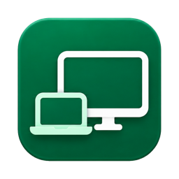

<p align="center">
  
</p>

<h1 align="center">MacTop</h1>

<p align="center"><strong>Restore your desktops and windows when you connect or disconnect a monitor.</strong></p>

<p align="center">Free · Open source · macOS 26.4 or later</p>

<p align="center">
  <strong><a href="#installation">Download MacTop</a></strong>
  ·
  <strong><a href="https://ko-fi.com/zereslab">☕ Support MacTop on Ko-fi</a></strong>
</p>

Unplug your home monitor and macOS may move its desktops to your MacBook. Plug it back in and the monitor may show a single desktop. **MacTop remembers how you work on each display.** It returns the original desktops it can identify, restores their order, and repositions open windows without closing or relaunching your apps.

| When you use… | MacTop applies… |
| --- | --- |
| Just your MacBook | The shared **MacBook** profile |
| Your home monitor | The layout saved for that monitor |
| Your office monitor | Its own layout, with its windows and desktops |

## Installation

**[Download MacTop 0.1.10 Beta 1](https://github.com/CarlosCaceres86/MacTop/releases/download/v0.1.10-beta.1/MacTop-0.1.10-universal.zip)** for Apple silicon and Intel Macs.

You need a MacBook running **macOS 26.4 or later** and, if you use an external display, connect it in extended mode. In **System Settings → Desktop & Dock → Mission Control**, turn on **Displays have separate Spaces**. MacTop supports one external monitor at a time and restores numbered Mission Control desktops. Restoring full-screen and Split View Spaces is outside the scope of this beta.

1. Unzip the download and move `MacTop.app` to **Applications**.
2. Open MacTop from **Applications**.
3. MacTop appears in the menu bar. Grant **Accessibility** permission when prompted so it can move windows and use Mission Control.

MacTop supports English and Spanish. It uses the language macOS selects for the app, with English as the fallback.

### Build from source

Build the app from source with the Xcode tools and Swift 6.

```sh
git clone https://github.com/CarlosCaceres86/MacTop.git
cd MacTop
./scripts/build-app.sh
```

Open `dist/MacTop.app` or copy it to **Applications**. The local build includes both architectures and uses ad hoc signing.

## Getting started

1. **Save the MacBook profile.** With no external monitor connected, arrange your windows and choose **Save Layout for MacBook…**.
2. **Save a profile for each monitor.** Connect your home or office monitor, arrange its desktops, and choose **Save Layout for [display name]…**. If you already saved a profile, MacTop automatically associates it with its monitor.
3. **Turn on Automatic Restoration.** You can first try **Restore Now**. With automatic restoration enabled, try the sequence home → MacBook → office → MacBook → home.

When changes are needed, an overlay appears during restoration and disappears when it finishes. MacTop returns desktops in one Mission Control session when possible, creates missing destinations, and keeps any extra desktops. If macOS interrupts a move that MacTop cannot confirm, the menu tells you when to use **Restore Now**.

## Privacy and permissions

MacTop runs locally, without an account or telemetry. It stores profiles in `~/Library/Application Support/MacTop`. They include app, window, monitor, and desktop identifiers, as well as positions. The current capture leaves window titles empty and does not save the contents of your documents.

Accessibility allows MacTop to move windows from other apps and operate Mission Control. MacTop also uses private macOS interfaces to identify desktops and verify moves. A macOS update may affect restoration.

To remove your profiles, quit MacTop and delete its folder in **Application Support**. Manage the permission in **System Settings → Privacy & Security → Accessibility**.

## Contributing

You can test restoration with your monitor, submit an improvement, or open an issue with steps to reproduce it. Include your macOS version, how many desktops you expected, and what happened. Use fictional or anonymized examples to protect your profile data. [Open an issue](https://github.com/CarlosCaceres86/MacTop/issues/new)

Run the test suite from the repository root.

```sh
swift test
```

The [MVP plan](tasks/plan.md) and [implementation notes](tasks/todo.md) document technical decisions, validation, and release preparation.

## Support MacTop

If MacTop saves you from rearranging your windows, a one-time tip helps me test more monitor setups and keep MacTop working across macOS updates.

[Support MacTop on Ko-fi](https://ko-fi.com/zereslab)

## License

MacTop is distributed under the [MIT license](LICENSE). Code derived from SpacePigeon, yabai, Ferry, and Spaceballs retains its authors' licenses and notices. [SpacePigeon, yabai and Ferry](Vendor/SpacePigeon/README.md) · [Spaceballs](Vendor/Spaceballs/README.md)
